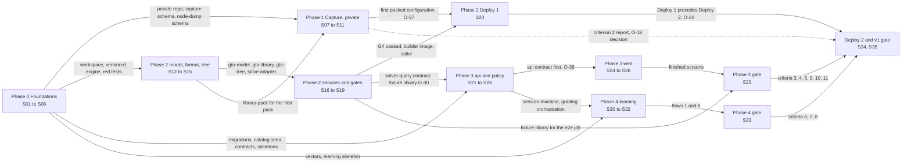

# v1 sprint roadmap (sprint/1-v1)

Back to [[projects/g-tee-oh/g-tee-oh|g-tee-oh index]]. Related: [[projects/g-tee-oh/planning/01-product-spec|01 Product spec]], [[projects/g-tee-oh/planning/07-roadmap|07 Roadmap]], [[projects/g-tee-oh/planning/00-open-questions-and-risks|00 Open questions and risks]]. Decisions cited as ADR nnnn (architecture decision record) live in [[projects/g-tee-oh/decisions/_README|ADR index]]. Answered questions are cited by O-ID from 00; questions this roadmap proposes start at O-38 (section 10). This file is public-safe: capture detail lives only in [[projects/g-tee-oh/planning/03-phase-1-data-acquisition|03 Phase 1 data acquisition]] and [[projects/g-tee-oh/planning/architecture/A8-capture-system|A8 capture system (private)]], and this roadmap refers to it by link and by O-19.

## 1. Summary

What v1 is:

1. A preflop trainer served from a solutions library: study browser, trainer in spot, street and full-hand modes (ending when the flop is dealt), drills in a schema that mirrors the reference tool, grading by expected value (EV) loss with bet buckets, a noise floor and labels, random number generator (RNG) mode, confidence taps, prediction drills, range painting, insight cards, and template and on-request explanations.
2. The library is bootstrapped from reference solutions captured privately in Phase 1, while the own engine passes gates G1 to G4 and G6a and a background builder on the Mac starts filling the heads-up postflop library from Deploy 1 onward, writing scenarios (O-17).
3. A learning engine: Glicko-2 per track with fractional outcomes, Free Spaced Repetition Scheduler (FSRS) scheduling, Bayesian Knowledge Tracing (BKT) mastery, leak cost, automated interleaved training, progress views, holdout and streaks.
4. Library-first throughout: no request path starts a solve, and coverage, gap requests and the admin builder screen are product features (ADR 0018, O-36).
5. v1 is done when all eleven success criteria in 01 section 6 pass with a test in continuous integration (CI) or a saved report, and both deploys have happened.

Dates and branches. Day 1 is 2026-10-20 (O-37). The target for the v1 gate is day 31, 2026-11-19, at roughly a third of a Max plan per week (R-12; pacing in section 4 and O-39). Work happens on feature branches `p<phase>/<slug>` that merge by pull request into the sprint branch `sprint/1-v1`, which merges into `main` in the release session S35, after the v1 gate report (R4.17, R4.18; A1 section 4, O-28). Every public session runs in Claude Code in PowerShell at the clone `C:\Users\stack\projects\g-tee-oh`; Rust builds with the native Windows toolchain, and Windows Subsystem for Linux 2 (WSL2) is used only for Linux container builds and benchmarks (O-23). The exceptions are the two deploy sessions, which run on the Mac (O-59), and S04, which happens at the Mac with Claude as the checklist. Visual testing happens on local ports with owner screenshots. Nothing deploys to the Mac without the owner's explicit yes at that moment.

Two deploy events (O-20). Deploy 1 closes Phase 2 (session S20, paced for week 3): Postgres, SeaweedFS and the library builder on the Mac, images built there, the reference library imported, the builder left running. Deploy 2 closes Phase 4 (S34, paced for day 31): the full stack, the user, backups, the restore drill and the Mac latency numbers for criterion 10 (O-21).

Relation to 07 Roadmap. 07 is indicative and runs the phases almost in sequence. This roadmap keeps its phase numbers and gates, replaces the sequence with a dependency order (only one Phase 2 step and one Phase 3 test need captured data), turns its checklists into requirements with IDs and named tests, maps execution sessions, and paces them by Claude usage. Where 07's wording is stale, the answered questions and the architecture set win (O-27).

## 2. Phase table

Earliest starts are dependency-limited; paced dates come from section 4. Usage counts sessions at high 3, medium 2, low 1.

| Phase | Name | Goal | Earliest start | Expected duration | Gate | Claude usage |
|---|---|---|---|---|---|---|
| 0 | Foundations and test scaffolding | A public monorepo with seven CI jobs and the private-data guard, the contracts pipeline and service skeletons, red tests for every later vector, a dev stack on the Zenbook, a private capture repo scaffold, a bootstrapped Mac with a first memory reading | Day 1 (2026-10-20) | 3 days of repo work in week 1; the Mac bootstrap any evening through week 2 | CI green on `sprint/1-v1` on all seven jobs; compose up healthy; the guard rejects a planted private-pattern file and a planted hashed identifier; every vector is a pending test tagged with its R ID; the contracts job fails on an uncommitted diff (the repo part, closed at S06); the bootstrap report exists (the Mac part, closed when S04 lands, no later than S20, O-67) | 1 high, 3 medium, 2 low (11 units) |
| 1 | Data acquisition and aggregation (private) | The v1 capture set per O-19 captured, QA-passed (quality assurance), normalized and packed into the generic library format as reference solutions, with sizing conventions per configuration, and the first configuration packed before S20 (O-37) | Day 3 (2026-10-22) | 11 days by dependency, exit day 13 earliest; paced exit in week 4; the campaign continues in the background (ADR 0021) | The private doc's section 9 checklist as amended by O-19 (the next capture step is not a gate condition); the criterion 2 report; the O-18 decision written; full-history guard clean | 3 high, 1 medium, 1 low repeating whose first sitting counts medium: 13 units plus about 3 units of S09 check-ins across weeks 2 to 4 (O-42), 16 in all |
| 2 | Engine validation and solution pipeline | The engine trusted through G1 to G4 and G6a, the library format and read service, the planner and builder with runout extraction, the public fixture library, Deploy 1 with the builder running on the Mac | Day 2 (2026-10-21) | 8 days by dependency; Deploy 1 day 9 earliest, paced for about day 21 (2026-11-09) | G1 to G3 pass in CI; G4 and G6a reports pass; a simple-tree flop solve runs on the Mac inside 5 GB; the no-solve tests pass; the Deploy 1 report meets the memory and storage pass rules (O-50, O-51) | 4 high, 5 medium (22 units) |
| 3 | Preflop trainer | api, study browser, trainer in three modes (preflop), grading policy, drills with the build card, prediction and painting, insights and explanations, coverage and admin screens; criteria 3, 4, 5, 9, 10 (Zenbook part) and 11 | Day 3 (2026-10-22) | 6 days by dependency; gate day 8 earliest, paced for about day 29 (2026-11-17) | Criteria 3, 4, 5, 9, 10 (Zenbook) and 11 pass; end-to-end flows 2 to 5 green in the CI `e2e` job; the owner has reviewed screenshots from a local port | 7 high, 2 medium (25 units) |
| 4 | Rating, scheduling, progress, Deploy 2 and the v1 gate | The learning engine, automated training, progress views, holdout and streaks, Deploy 2, the v1 gate report; criteria 6, 7, 8 and criterion 10's Mac number | Day 4 (2026-10-23) | 11 days by dependency; v1 gate day 14 earliest (bounded by the Phase 1 exit), paced for day 31 (2026-11-19) | Criteria 6, 7 and 8 pass; anti-farming tests pass; flows 1 and 6 green in CI; the Deploy 2 report shows the Mac 95th percentile latency (p95) inside both budgets and a passed restore drill; the v1 gate report lists all eleven criteria with report paths; `sprint/1-v1` merged to `main` | 3 high, 2 medium, 1 low (14 units) |

## 3. Dependency graph

Dependency edges with reasons (session ids are defined in section 5):

- Phase 0 blocks Phase 1: the private repo, its `capture` schema and the bucket credentials come from S02 and S03; the node-dump schema the private exporter writes to comes from S06 (A8 section 1).
- Phase 0 blocks Phase 2, 3 and 4: the workspace and vendored engine (S01), the red tests (S05), the migrations and catalog seed (S02), the contracts pipeline and skeletons (S06).
- Phase 1 blocks Phase 2 at one point only: the builder's first real build needs a packed first configuration with its sizing convention (O-37, R1.7 to R2.22); O-61 covers the late case.
- Phase 2 blocks Phase 3: the `solver-query` contract (A1 section 3) and the G6a plus synthetic fixture library (O-30, O-57).
- Phase 2 blocks Phase 4: Deploy 1 precedes Deploy 2 (O-20).
- Phase 3 blocks Phase 4: the session machine and grading orchestration (S23) carry the learning updates (S31); the Phase 3 gate precedes the v1 gate.
- S01 blocks S02, S03, S05, S06, S12: the workspace, CI and guard exist before anything lands; the private repo mirrors the guard patterns and commit conventions.
- S02 blocks S06 (codegen), S10 (bucket credentials and the `capture` role), S16, S18 and S21 (the `query` role, the `build_job` tables and the Kysely types, O-28).
- S03 blocks S07: the private repo and its guardrails exist before reconnaissance (R-15).
- S04 blocks S20: Deploy 1 needs the bootstrapped Mac (O-20).
- S16 is a practical input to S10 (a packed node is read back through solver-query for R1.5) and S15 to S11 (the public sizing test for R1.6 runs locally); both are paced earlier, so neither edge delays a session.
- S05 blocks S13, S22 and S30: the toy-game fixtures, the OpenSpiel curve and the learning vectors are the red tests those sessions turn green. S12 is not blocked by S05: it writes the two gto-model vectors (the bucket-edge table and the node-key round trip) red first inside its own session and then turns them green (R0.11).
- S06 blocks S10 (the node-dump schema), S16, S21 and S24: contracts and generated clients exist before any handler or screen (A1 section 3).
- S07 blocks S08 (the tooling is built from the recon report), S24 (component library, ADR 0006, with the A7 fallback per O-44), S26 (drill schema confirmation, fallback 05 section 4 as written) and S11's O-18 decision (the availability map).
- S08 blocks S09: the campaign runs the tooling only after the cross-check in the private doc passes.
- S09 blocks S10 (the first real payloads) and S11 (the campaign complete for the O-19 set).
- S12 blocks S13, S14, S15 and S19: toy games, records, trees and push/fold all use the canonical encodings.
- S13 blocks S16 (the 169 by 169 equity table, O-32, and the report format) and S17 and S19 (the `tools/validate` tool).
- S14 blocks S10 (`tools/library-pack`), S16 (the reader), S18 (the writer) and S19 (G6a writes library format).
- S15 blocks S17 (G4 compares the adapter's output), S18 (the builder calls the adapter and extraction) and S19 (push/fold trees come from `gto-tree`).
- S16 blocks S23 (api calls the generated client; the committed contract lifts the block a day early, O-38), S27 (insights) and S29 (the p95 guard and dependency tests run on the real service).
- S17 blocks S20: the builder starts on the Mac only after G4 passes (04 section 3, E6).
- S18 blocks S20: the builder is what Deploy 1 ships.
- S19 blocks S23, S29 and S33: the fixture library is what the integration tests and end-to-end flows run against (O-30).
- The first-pack checkpoint (S10, O-37) blocks S20; S20 blocks S34 (Deploy 2 builds on the Deploy 1 stack).
- S21 blocks S23 (the Fastify skeleton and auth) and S24 (the web client is generated from the api contract, O-38).
- S22 blocks S23 (grading orchestration calls the policy), S25 (grouping labels and the RNG band mapping) and S30 (the learning core builds on the policy types).
- S23 blocks S25, S27 and S28 (screens call the endpoints) and S31 (learning updates hang off the session machine).
- S24 blocks S25, S28 and S32: every screen uses the foundation components.
- S25 blocks S26 (street and full hand extend spot mode), S27 (cards render inside the feedback panel) and S32 (automated mode reuses the trainer screen).
- The build card (owner task, O-24) blocks S26's acceptance file.
- S26, S27 and S28 block S29; S30 blocks S31; S31 blocks S32; S32 blocks S33.
- S11 softly blocks S29 (criterion 11 prefers captured live data; the synthetic live sets stand in, O-57) and blocks S34 (the criterion 2 report goes into the v1 gate report).
- S29, S33 and S20 block S34; S34 blocks S35 (the release follows the gate report).

## 4. Critical path and parallel tracks

Longest chain by dependency, 14 days: S03 (day 2, after the S01 scaffold) to S07 (days 3 and 4) to S08 (day 5) to S09 (day 6, then the unattended campaign) to S11 (day 13) to S34 (day 14, 2026-11-02). The capture campaign sets this chain's length, but nearly all of it is unattended and costs only the daily check-in, so it never binds the paced calendar.

Longest public chain, the engine read path, 10 days: S01 (1) to S12 (2) to S14 (3) to S16 (4) to S23 (5) to S25 (6) to S26 and S27 (7) to S29 (8), joined by S20 (9, after the first pack on day 8) into S34 (10; its calendar day is 14, set by the capture chain). Every session on it is high usage, so it goes first in each week's queue.

What this plan does to the sequential order in 07: the engine crates and toy gates start on day 2 beside the scaffold; the grading policy and the learning core are pure TypeScript and start on days 3 and 4; the api starts on day 4 from the migrations and contracts, before `solver-query` exists; the web foundation starts on day 5 from the committed api contract; the capture campaign runs unattended from day 6 and feeds Phase 2 through one checkpoint; Deploy 1 sits off the public chain while the builder fills the library on the Mac; the Phase 3 and Phase 4 gates run side by side.

Parallel tracks (sessions that can run at the same time, in dependency order):

| Track | Sessions in order | Earliest window |
|---|---|---|
| A, engine read path (public critical chain) | S12, S14, S16, S23, S25, S26, S27, S29, S34 | days 2 to 14 |
| B, capture (private) | S03, S07, S08, S09, S10, S11 | days 2 to 13 |
| C, toy gates and fixtures | S05, S13, S17, S19 | days 2 to 4 |
| D, builder and Mac | S04, S15, S18, S20 | days 1 to 9 |
| E, product shell | S02, S06, S21, S24, S28 | days 2 to 6 |
| F, learning | S22, S30, S31, S32, S33 | days 3 to 8 |

Parallel groups by earliest day: group A (day 1) S01, S04; group B (day 2) S02, S03, S05, S12; group C (day 3) S06, S07 (into day 4), S13, S14, S15, S22; group D (days 4 and 5) S08, S16, S17, S18, S19, S21, S23, S24, S30; group E (days 6 and 7) S09, S10, S25, S26, S27, S28, S31, S32; group F (days 8 and 9) first pack, S20, S29, S33; group G (days 10 to 15) S11, S34, S35.

Paced calendar. The plan is about 88 units. A third of a Max plan per week supports roughly 16 to 20 units, so the dependency-limited 14 days stretch to about 31 (R-12, O-39). Track A goes first in every week's queue:

| Week | Days and dates | Sessions in order | Units |
|---|---|---|---|
| 1 | 1 to 7, 2026-10-20 to 2026-10-26 | S01, S03, S04 (any evening), S12, S02, S05, S06, S07 (two sittings), S14 | 20 |
| 2 | 8 to 14, 2026-10-27 to 2026-11-02 | S13, S15, S21, S22, S08, S09 (campaign starts; check-ins from here), S16, S18 | 21 (20 plus one unit of S09 check-ins, O-42) |
| 3 | 15 to 21, 2026-11-03 to 2026-11-09 | S10 (first pack early in the week), S19, S17, S30, S24, S23, S20 (Deploy 1 about day 21) | 19 (18 plus one unit of S09 check-ins, O-42) |
| 4 | 22 to 28, 2026-11-10 to 2026-11-16 | S11 (Phase 1 exit), S25, S28, S31, S26, S27, S32 | 20 (19 plus one unit of S09 check-ins, O-42) |
| 5 | 29 to 31, 2026-11-17 to 2026-11-19 | S29, S33, S34 (Deploy 2 and the v1 gate), S35 | 8 |

Weeks 1 to 4 run at the top of the budget because the critical chain, the capture setup and the Phase 0 scaffolding all front-load. If usage runs short, the trims in order are: fold S28 into S25; fold S35 into S34; fold S33 into S29 as one gate workflow; ship the Ask path flag-only and move prediction and painting (R3.16, R3.17) into S26, which turns S27 into a medium session; let S11 slide to week 5, since only criterion 11 prefers captured data and the criterion 2 report is attached at the gate. Never defer a gate. At a flat 16 units a week without trims the v1 gate lands around day 38 (2026-11-26).

## 5. Session map

Session ids are in execution order. S00 is the planning session. Every workflow session names what its verifier agent runs. "Two sittings" marks the one session that cannot finish in one sitting and gets one handoff with a stop point; the stop point is stated in its goal column so the handoff can size both sittings.

| Session id | Phase | Branch | Parallel group | Workflow or single session | Private or public | Goal | Claude usage |
|---|---|---|---|---|---|---|---|
| S01 | 0 | p0/foundations | A (day 1) | Workflow: after the subtree import lands, three tracks fan out (Cargo workspace and crate stubs; pnpm workspace and package stubs; the seven CI jobs, guard and CLAUDE.md); a verifier runs the planted-file and planted-identifier tests and the licenses job on a throwaway AGPL (GNU Affero General Public License) dependency | public | Monorepo scaffold, vendored engine, CI, guard with the hashed denylist, conventions, docs mirror seed (R0.1 to R0.4, R0.12) | high |
| S02 | 0 | p0/infra | B (day 2) | Workflow: compose and Dockerfiles; migrations, roles and the catalog seed; codegen and the benchmark harness are independent, joined by the compose-up smoke test; a verifier runs the role tests | public | Compose dev profile, Dockerfiles, migrations with roles and the seeded catalog, codegen wiring, Zenbook benchmark baseline (R0.5, R0.6, R0.10) | medium |
| S03 | 0 | p0/capture-repo (private repo) | B (day 2) | Single: one small repo, sequential setup | private | Private capture repo scaffold per A8 (R0.8); bucket credentials wired once S02 lands | low |
| S04 | 0 | p0/mac-bootstrap | A (any evening through day 8; may slip to any evening before S20, O-67) | Single: the owner at the keyboard, Claude as checklist | public | Mac bootstrap per O-20 and the throwaway flop-solve benchmark; the report lands at `validation/reports/mac-bootstrap.md` carrying only memory, the power setting, peak resident set size (RSS) and seconds per iteration, and closes the Mac part of the Phase 0 gate (R0.9, O-47, O-50) | low |
| S05 | 0 | p0/test-vectors | B (day 2) | Workflow: three lanes (learning vectors; engine fixtures including the OpenSpiel run with uv; the report format and learning skeleton); a verifier checks that every test carries an R ID and is pending | public | Red tests and fixtures first (R0.11) | medium |
| S06 | 0 | p0/contracts | C (day 3) | Single: one pipeline end to end; then confirms the p0 branches are merged into `sprint/1-v1` and the repo part of the Phase 0 gate holds (the Mac part closes when S04 lands) | public | Contracts pipeline, service and web skeletons, e2e skeleton with the fixture path, Phase 0 gate repo part (R0.7, R0.3 e2e part) | medium |
| S07 | 1 | p1/recon (private repo) | C (days 3 and 4) | Single, two sittings: the owner is present and judgement is needed at every step, so nothing fans out | private | Reconnaissance report; sanitized feature map and drill schema into the vault (R1.1). Stop point: sitting 1 ends when the availability map and the data delivery map (private doc section 3) are written, which gives the O-3 and O-18 first reading; sitting 2 produces the feature map, the drill schema confirmation, the frontend stack note (O-44) and the sanitized vault copies | high |
| S08 | 1 | p1/capture-tooling (private repo) | D (day 5, after S07's second sitting) | Workflow: the tooling modules are independent over one schema; a verifier runs the guardrail tests and the cross-check | private | Capture tooling with the A8 guardrails; cross-check (R1.2) | high |
| S09 | 1 | p1/campaign (private repo) | E (day 6 start), then daily | Single: the first run is watched end to end, then one short check-in per day under one repeating handoff (O-42) | private | Start the unattended campaign in value order; daily check-ins review the log and QA report and restart or adapt (R1.9) | low per sitting (medium for the first) |
| S10 | 1 | p1/normalize-qa (private repo) | E to F (days 6 to 8; first pack day 8) | Workflow: normalizer, QA runner and exporter are independent modules over one schema; a verifier runs the pack round trip | private | Normalizer, QA runner, exporter to the node-dump schema; pack the first configuration and insert its sizing convention (R1.4, R1.5, R1.7) | high |
| S11 | 1 | p1/exit (private repo) | G (day 13) | Workflow: packing by configuration group, sizing derivation and report assembly fan out; a verifier runs the full-history guard and checks the sanitized vault copies against O-26 | private | Phase 1 exit: full pack, sizing rows, fixtures, coverage, QA and availability reports, O-18 decision, guard scan (R1.3, R1.6, R1.8, R1.10, R1.11) | medium |
| S12 | 2 | p2/model | B (day 2) | Workflow: four modules (cards and indexes; isomorphism; keys; rake and buckets), each writing its R0.11 vectors red first (bucket-edge table, node-key round trip) and then turning them green; a verifier runs the property tests | public | gto-model (R2.1 to R2.3) | high |
| S13 | 2 | p2/toy-gates | C (day 3) | Workflow: one agent per gate and one integrator for the command-line interface (CLI), the CI job and the equity table; a verifier checks the reports against the pass rules | public | tools/validate with G1, G2, G3, reports, CI wiring; the 169 by 169 equity table fixture (R2.4 to R2.6, R2.20 table part) | medium |
| S14 | 2 | p2/library-format | C (day 3) | Workflow: writer, reader, pack tool and manifest finalization in parallel, joined by the round-trip and snapshot tests; a verifier runs the invariant rejection test and the size estimate | public | Library format E1, tools/library-pack, synthetic-record size estimate, reader benchmarks (R2.7, R2.8) | high |
| S15 | 2 | p2/tree-solve | C (day 3) | Single: two crates with one integration test | public | gto-tree and the heads-up postflop solve adapter (R2.9, R2.10) | medium |
| S16 | 2 | p2/solver-query | D (day 4) | Workflow: the OpenAPI file is committed first (O-38); then one agent per endpoint group (nodes and grade; insights; deal and sample; coverage and operations) and one for the contract, the dependency test and the latency bench; a verifier runs the grade recomputation check | public | solver-query with insights, OpenAPI and client, no-solve dependency test, latency bench (R2.13 to R2.15) | high |
| S17 | 2 | p2/g4-oracle (private repo) and p2/validate-g4 (public) | D (day 4) | Single: a run-and-compare session with one artifact | private repo, handoff public-safe (O-43) | G4 oracle program linking the AGPL crates privately, generic oracle dump, public validate step and report (R2.11) | medium |
| S18 | 2 | p2/builder | D (day 4) | Workflow: planner, build loop, extraction and operations endpoints in parallel, joined by the integration test; a verifier runs the tiny real solve | public | gto-planner, builder loop, runout extraction, settings, ledger, health, `--once`, Zenbook benchmark of one flop line (R2.12, R2.16 to R2.18) | high |
| S19 | 2 | p2/g6a-fixtures | D (day 4) | Workflow: the push/fold solver and its report; the fixture generator with the synthetic live sets; the spike measurement; a verifier checks pack invariants and seed determinism | public | G6a push/fold, synthetic fixture library, Zenbook spike inside 5 GB (R2.19, R2.20, R2.21) | medium |
| S20 | 2 | p2/deploy-1 | F (day 9; paced week 3) | Single, two sittings on two machines: the Zenbook first-build sitting (O-41), then the Mac deploy sitting with the owner present (O-59) | public | First real build on the Zenbook (O-41), then Deploy 1 with the owner's yes, builder on the Mac, Mac spike rerun, Deploy 1 report, Phase 2 gate (R2.21 Mac part, R2.22) | medium |
| S21 | 3 | p3/api-foundation | D (day 4) | Workflow: the OpenAPI file is committed first (O-38); auth and users; catalog and drill CRUD (create, read, update, delete); contracts, errors and idempotency as tracks over one Fastify skeleton; a verifier runs the security tests | public | api foundation, auth, catalog, drill CRUD (R3.1, R3.2, R3.14 CRUD part) | high |
| S22 | 3 | p3/grading-policy | C (day 3) | Single: one pure module whose spec is 05 section 6 and the R0.11 table; one agent keeps the edge cases coherent | public | Grading policy, grouping modes, RNG band mapping with the chi-square test, calibration aggregation in packages/learning (R3.8, R3.10 mapping part, R3.11 stat part) | medium |
| S23 | 3 | p3/api-trainer | D (day 5) | Workflow: study and coverage; session machine and grading orchestration; admin and SSE (server-sent events), each against the fixture solver-query (O-53); a verifier runs the replay-from-seed and request-path tests | public | Study, coverage, admin endpoints, session state machine, grading orchestration, SSE (R3.3 to R3.7) | high |
| S24 | 3 | p3/web-foundation | D (day 5) | Workflow: shell and auth; table and cards; matrix canvas; test harness as tracks over the generated client; a verifier runs the smoke flow and the matrix frame bench | public | Web foundation: Vite app, router, query, store, component library (recon or the A7 fallback, O-44), login, home shell, core components, Vitest and Playwright (foundations of R3.12, R3.13) | high |
| S25 | 3 | p3/web-study-trainer | E (day 6) | Workflow: study screen; trainer screen; RNG and feedback components, joined by flows 3 and 4; a verifier runs them on a local port and hands the owner screenshots | public | Study browser and trainer spot mode with confidence tap, feedback panel, RNG roller and explainer, grouping labels, hotkeys (R3.9 to R3.13 spot part) | high |
| S26 | 3 | p3/drills | E (day 7) | Workflow: street and full-hand modes; drill screens; the acceptance file, joined by flow 2; a verifier runs the acceptance against the fixture library and, locally, the reference library | public | Street and full hand to the flop, drill builder and library screens, import and export, build-card acceptance (R3.13 rest, R3.14, R3.15) | high |
| S27 | 3 | p3/insights-explanations | E (day 7) | Workflow: four independent features over one insights contract; a verifier runs the number-membership and planted-number tests | public | Prediction drills, range painting, insight cards, More info templates, Ask path with validator, cap and mocked model (R3.16 to R3.20) | high |
| S28 | 3 | p3/coverage-admin | E (day 6) | Single: two screens over endpoints S23 already built | public | Coverage view, gap requests, admin builder screen (R3.4 screen part, R3.5) | medium |
| S29 | 3 | p3/gate | F (day 8) | Workflow: one agent per success criterion writing or running its test, one on the CI e2e job; a verifier confirms every p3 branch is merged and runs the visual pass with screenshots | public | Phase 3 gate: recompute report, bucket edges and chi-square, build-card run, template and validator tests, dependency and request-path tests, Zenbook p95 guard, keying test, flows 2 to 5 in CI (R3.21, R3.22 and the closing tests of 3, 4, 5, 9, 10, 11) | high |
| S30 | 4 | p4/learning | D (day 4) | Workflow: rating (Glicko-2, difficulty, rank and tiers), scheduling (FSRS, BKT, queue) and leak cost as independent pure modules against the R0.11 vectors; a verifier runs the simulation | public | packages/learning core (R4.1 to R4.9) | high |
| S31 | 4 | p4/api-learning | E (day 6) | Workflow: automated loop; learning state writes; holdout, streaks and progress endpoints; a verifier runs the integration test and the holdout property | public | api learning integration: tracks, rating per session, FSRS and BKT per review block, leak stats and weekly job, automated training, anti-farming, holdout, streaks, progress endpoints (R4.10, R4.11, R4.13, R4.14) | high |
| S32 | 4 | p4/web-progress | E (day 7) | Workflow: charts after the dataviz pass; automated mode screens; home and settings; a verifier runs flow 6 on a local port with screenshots | public | Progress screen, automated training start and recap, home queue and streak, cosmetics settings (R4.12) | high |
| S33 | 4 | p4/gate | F (day 8) | Single: running and recording tests already written; confirms every p4 branch is merged | public | Phase 4 gate: worked example, simulation, anti-farming, vectors, aggregation fixtures, flows 1 and 6 in CI, tau and threshold revisit (R4.15 and the closing tests of 6, 7, 8) | medium |
| S34 | 4 | p4/deploy-2 | G (day 14; paced day 31) | Single: operations in order at the Mac with the owner present (O-59) | public | Deploy 2 with the owner's yes, seed, import, user, backups, restore drill, Mac p95, v1 gate report (R4.16, R4.17) | medium |
| S35 | 4 | p4/docs-release | G (day 15, after S34) | Single: documentation, SBOM (software bill of materials) and a tag | public | Docs mirror refresh, docs/security.md review, README, SBOM, tagged release with images, merge to main (R4.18) | low |

Totals: 35 sessions, 22 run as workflows and 13 as single sessions; 7 are private (S03, S07 to S11 and S17 in the private repo, S17 with a public-safe handoff).

## 6. Requirements

Every requirement closes with a named test or a gate artifact. Private tests run in the capture repo and their reports stay there; everything else runs in public CI or writes under `validation/reports/`.

### Phase 0

| R ID | Statement | Test or gate | Success criterion |
|---|---|---|---|
| R0.1 | Monorepo per [[projects/g-tee-oh/planning/architecture/A1-repo-and-conventions|A1]]: Cargo and pnpm workspaces, justfile, CLAUDE.md with the branch rules (`sprint/1-v1`, `p<phase>/<slug>`, O-28), the co-author trailer rule (O-29), the clone path `C:\Users\stack\projects\g-tee-oh`, the PowerShell shell and the toolchain split (native Windows Rust day to day, WSL2 only for container builds and benchmarks; O-23), `.claude` deny rules, pull request template listing R IDs (A9 section 1) | CI `rust` and `ts` jobs green on the empty workspaces; `just --list` shows the task surface; a commit-msg hook rejects a Claude commit without the trailer; a test asserts the template carries the R-ID field | none |
| R0.2 | Engine vendored by git subtree into `crates/vendor/postflop-engine`, MIT notice kept, `UPSTREAM.md` records the commit; cargo-deny and the pnpm license check block the GNU General Public License (GPL) and AGPL (ADR 0002) | Vendored crate builds in CI; licenses job passes; a throwaway branch adding an AGPL crate fails the licenses job, recorded in `validation/reports/phase-0-gate.md` | none (supports 1) |
| R0.3 | The seven CI jobs from [[projects/g-tee-oh/planning/architecture/A9-quality-security-ops|A9]] section 2: `rust`, `ts`, `contracts`, `e2e` (compose with the fixture library path, O-62), `licenses`, `security`, `images` (multi-arch buildx, push on tags only) | Every job runs on a pull request; the e2e skeleton passes the Playwright smoke flow; the images job builds amd64 and arm64 for one service | none |
| R0.4 | Private-data guard as a pre-commit hook and a CI check: file patterns plus an identifier denylist stored as salted sha256 hashes (O-58); `just guard-history` scans the full history (R-11) | Guard unit tests with synthetic planted strings; a throwaway branch with a planted private-pattern file and a planted hashed identifier is rejected locally and in CI | none |
| R0.5 | Compose `dev` profile with Postgres, SeaweedFS single-server mode and Caddy; one multi-arch Dockerfile per service; `.wslconfig` template for the WSL2 container builds and benchmarks (O-23); `.env.example` | `docker compose --profile dev up` reaches healthy on the Zenbook; health-check smoke in the e2e skeleton | none |
| R0.6 | dbmate migrations for the [[projects/g-tee-oh/planning/architecture/A4-data-model|A4]] schema with `scenario` in v1 (O-17), `game_config.ante_cbb` default 0 (O-33), roles `app`, `builder`, `capture` and the read-only `query` role (O-28); catalog seed: stakes (live 1/3 cap $5, live 2/5 cap $5 flagged unverified per O-2 and O-66, one online profile) and every v1 configuration from 01 section 3 with a placeholder sizing convention (source `manual`), so the not-null constraint holds before Phase 1 data lands | Migration test applies to an empty database; role tests: `query` cannot write, `app` cannot see the `capture` schema, `capture` can insert only `solution` rows with source `reference`, `stake`, `sizing_convention` and `game_config` rows; Kysely codegen and sqlx checks pass; a seed test counts one `game_config` per v1 configuration | 11 (keying data), supports 10 |
| R0.7 | Contracts pipeline and skeletons (A1 section 3): utoipa to `solver-query.openapi.json`, Fastify Zod to `api.openapi.json`, openapi-typescript clients, manifest and node-dump JSON (JavaScript Object Notation) schemas carrying a schema version, kysely-codegen; axum hello with `/healthz`, Fastify hello serving `/api/v1/openapi.json`, Vite skeleton with router and a Playwright smoke flow | `contracts` job regenerates and fails on diff; the smoke flow passes in the e2e skeleton | none (blocks every handler and screen) |
| R0.8 | Private `g-tee-oh-capture` repo scaffold: its own `capture` schema migrations, gitignored data directory, run-log table, separate `reference-private` bucket credentials; components per [[projects/g-tee-oh/planning/architecture/A8-capture-system|A8]] | Private repo CI applies its migrations; credential test: the `capture` role writes the bucket and the `app` role cannot read it | 2 (supports; R-11, R-15) |
| R0.9 | Mac bootstrapped per O-20: Docker virtual machine at 10 GB and all but 2 cores, sleep prevented on power, external drive mounted, repo cloned, release build cache warmed; a throwaway arm64 flop-solve benchmark of the vendored engine inside a 5 GB memory limit (O-47) | Bootstrap report at `validation/reports/mac-bootstrap.md` on branch `p0/mac-bootstrap`, carrying only `docker info` memory, the power setting, peak RSS and seconds per iteration against the flop-solve pass rule (O-50); it closes the Mac part of the Phase 0 gate whenever S04 lands, no later than S20, which checks it before Deploy 1 (O-67) | 10 (precondition; first reading for R-9) |
| R0.10 | Benchmark harness (criterion): solve iteration, chunk decode, node read; Zenbook baseline recorded | `just bench` writes `validation/reports/bench-zenbook.json` | 10 (guard baseline) |
| R0.11 | Red tests first, each tagged with its R ID and pending: the Glicko-2 worked example (A6 section 6), the ts-fsrs license verified and its published vectors wired to an empty adapter (O-35), the bucket-edge table (25, 50, 75, 110 and 150 percent of pot, upper edge inclusive, all-in separate) and a node-key round-trip skeleton (these two gto-model vectors land in S12, still red first inside that session, so S12 does not wait for S05), Kuhn, AKQ and Leduc fixtures, the OpenSpiel Leduc exploitability curve generated once with uv and committed with `PROVENANCE.md` (version, command, seed; O-30), the `validation/reports/` format; `packages/learning` skeleton with the A6 section 4 types | Tests exist and are pending with R IDs; CI green with pending tests; `PROVENANCE.md` present; licenses job passes | 1, 4, 6, 7 (scaffolds) |
| R0.12 | `docs/` mirror of the files Step 3 flags `public: true` (O-26, O-45) with a `docs/security.md` threat-model stub (A9 section 3) | Guard passes on `docs/`; a test that every file under `docs/` carries `public: true` provenance | none |

### Phase 1 (private; detail only in the private doc)

| R ID | Statement | Test or gate | Success criterion |
|---|---|---|---|
| R1.1 | Reconnaissance report in the private repo per the private doc section 3, answering O-3, O-7 and O-9, naming the component library (ADR 0006) and confirming the drill schema in [[projects/g-tee-oh/planning/05-training-and-grading|05]] section 4 | Recon exit checklist in the private doc; sanitized feature map and drill schema copied into the vault, flagged per O-26, guard passing on them | 5 (drill schema) |
| R1.2 | Capture tooling with the guardrails in A8, built from the recon report | Private tooling tests: each guardrail is exercised on a simulated trigger; the cross-check in the private doc section 4 passes | 2 (QA rule 7) |
| R1.3 | The v1 capture set per O-19 captured, each entry with a QA pass or marked unavailable or blocked with a reason, with the blocked share reported | Private coverage report plus QA report; this pair is the criterion 2 report | 2 |
| R1.4 | Normalization into the private `capture` schema with the seven QA rules from the private doc section 7, the preflop indifference tolerance applied as a QA rule and not as the grading floor (O-22) | Private QA report: 100 percent pass on every node used | 2 |
| R1.5 | Export to the generic node dump (schema from R0.7) and pack with `tools/library-pack` into `reference-private` with `solution` rows of source `reference` | Public: the pack round trip on a synthetic dump enforces the criterion 2 invariants (sums within 0.001, an EV per action, complete metadata) and rejects a dump that fails one; private: pack report listing every reference solution with its sha256; `solver-query` reads one packed reference node | 2, 3, 11 |
| R1.6 | `sizing_convention` rows (source `reference`) and `game_config` updates inserted by the `capture` role for every v1 configuration and stake, replacing the R0.6 placeholders; O-7 and O-9 resolved from the data and recorded in 00. Rows only, never public repo files (A4 section 3) | Public test: every `game_config` references a convention whose spec validates against the JSON schema and `gto-tree` builds a tree from each; private derived-sizing report | none (feeds R2.9, R3.2) |
| R1.7 | First configuration packed and its sizing convention inserted before S20, the Phase 1 to Phase 2 handoff (O-37) | `library-builder --once` consumes it on the Zenbook (R2.22, O-41) | none |
| R1.8 | Criterion 11 data decision (O-18): the closest captured live data at 1/3 and 2/5 identified and packed, or the fallback declared in writing (the synthetic live sets from R2.20 stand in, O-57) | Availability line plus a decision note in the exit report | 11 |
| R1.9 | Unattended campaign with one short check-in per day (O-34, O-42); run log per run; the campaign continues past the exit gate as background work (ADR 0021), which is not a gate condition (O-19) | Run log row per day; stop-report format test (private) | 2 |
| R1.10 | Validation fixtures from the aggregated reports for the builder's first position pairs, with provenance (consumed by G5 in v1.5) | Private loader validates each fixture against the node-dump schema | none |
| R1.11 | Full-history guard scan of the public repo at the exit gate | `just guard-history` report attached to the exit report | none (R-11) |

### Phase 2

| R ID | Statement | Test or gate | Success criterion |
|---|---|---|---|
| R2.1 | `gto-model` canonical encodings with test vectors: cards, 169-class and 1,326-combo indexes, canonical flop with multiplicity weights summing to 22,100, node key round trip, action tokens, spot-class key ([[projects/g-tee-oh/planning/architecture/A3-library-format|A3]] section 1) | Unit tests on the vectors; proptest node-key round trip, suit-permutation invariance, weight sum | 3 |
| R2.2 | Rake models (E2): one online profile; live 10 percent to the stake's cap converted to centi-big-blinds (cbb), no flop no drop (ADR 0014); configurations keyed by stake | Unit tests: 1/3 with a $5 cap gives 167 cbb; 2/5 with the $5 default gives 100 cbb; no rake at a preflop terminal; the same action at 1/3 and 2/5 yields a different `config_id` | 11 |
| R2.3 | Bucket mapping in `gto-model` with contiguous edges, upper edge inclusive, all-in separate (ADR 0008); the only implementation of this poker number (ADR 0004) | The R0.11 bucket-edge table passes: every edge, one tick above, all-in | 4 |
| R2.4 | G1 Kuhn poker: game value within 0.001 of minus 1/18, exploitability below 0.001 | `tools/validate` G1 report in the CI `rust` job | 1 |
| R2.5 | G2 AKQ and toy river games match closed-form bluff and defense frequencies within 0.5 points | G2 report in CI | 1 |
| R2.6 | G3 Leduc exploitability curve within tolerance of the committed OpenSpiel fixture (O-30) | G3 report in CI | 1 |
| R2.7 | Library format E1: node record, 8-bit frequencies and 16-bit loss units, zstd chunks, manifest with JSON Schema, sha256 checksums, `format_version`, reader with lazy chunks and a least recently used (LRU) cache bounded by `QUERY_CACHE_BYTES` | proptest quantize then dequantize within tolerance; insta snapshots of records and manifests; a corrupted checksum marks the build unavailable; chunk decode benchmark; synthetic-record size estimate recorded (R-19) | 3, 10 |
| R2.8 | `tools/library-pack` converts the node-dump schema into library format | A synthetic dump packs and reads back identically; a dump failing a criterion 2 invariant is rejected | 2 |
| R2.9 | `gto-tree`: preflop tree from a sizing convention spec, postflop tree config with at most one size per bucket per node, canonical tree hash | proptest: never two sizes in one bucket at a node (ADR 0020); insta golden for the hash, stable across machines | 4, 5 |
| R2.10 | Heads-up postflop solve adapter over the vendored engine: `estimate_bytes`, stop rule, progress sink, 16-bit default, exact best response | Integration test: a small flop solve reaches target; a problem above the cap is refused before allocation | none (supports the builder) |
| R2.11 | G4: heads-up river and turn spots versus the local oracles through a private Rust program linking the AGPL crates (O-31), which emits a generic oracle dump; a public `tools/validate g4` step compares | G4 report (both sides at 0.3 percent pot or better, mean absolute frequency difference under 2 points, root EV within 0.3 percent pot), stored privately | none (Phase 2 gate) |
| R2.12 | Runout extraction E6b in v1 (O-17): K runouts drawn uniformly by seed, every action branch kept, suit permutation applied from canonical to raw | proptest: permute then extract equals extract then permute | none (served in v1.5) |
| R2.13 | `solver-query`: `/v1/nodes`, `/v1/grade` with the preflop floor from O-22 (max of 0.2 percent pot, the reported accuracy, else 0.02bb), `/v1/insights`, `/v1/sample-action`, `/v1/deal` and reveal, `/v1/coverage`, `/healthz`, `/metrics`; utoipa OpenAPI committed first (O-38) with its TypeScript client; runs under the `query` role (O-28) | Contract diff job; grade equals a direct reader recomputation on a fixture solution; criterion benchmark: grade p95 under 30 ms with a warm cache | 3, 10 |
| R2.14 | Insights E3: threshold card, noise flags, equity distribution, range and nut advantage, blockers, hand role; preflop equities from the 169 by 169 table shipped with the fixtures (O-32) | Unit tests on hand-built nodes | 9 |
| R2.15 | No request path starts a solve: `solver-query` has no dependency on `gto-solve`; `api` and `solver-query` never invoke the builder | CI step: `cargo tree -p solver-query` must not contain `gto-solve`; `pnpm why` for `api`; the request-path integration test in R3.4 | 10 |
| R2.16 | `gto-planner`: build-job enumeration, priority from seat rotation times equilibrium reach (ADR 0013), storage budget, K per position pair (O-14), `blocked_budget` | Unit tests under a fixed budget; scheduling stops at the budget and evicts nothing | none (R-19) |
| R2.17 | Builder loop: `SKIP LOCKED` claim, exploitability check before publish, one-transaction publish of `solution` and `scenario` rows, `NOTIFY coverage_added`, three failures park the job | Integration test against Postgres and SeaweedFS with a tiny real solve; a parked job after three failures; the notify observed | 10, spec item 12 |
| R2.18 | `builder_setting` and `storage_ledger` editable without redeploy; health and metrics endpoint; `--once` mode | A setting change takes effect on the next claim; metrics scrape test | none |
| R2.19 | G6a heads-up push/fold: exact match to the computed equilibrium; agreement with published charts except at documented near-indifferent hands, with the chart source and parameters recorded; the solution committed in library format as the public fixture seed (O-30) | G6a report under `validation/reports/` in public CI (O-63) | fixture for 3, 4, 5, 9, 10 |
| R2.20 | Synthetic fixture generator in `validation/fixtures/`: a labeled synthetic 6-max preflop set (O-30) plus labeled synthetic live 9-handed sets at 1/3 and 2/5 with a `synthetic: true` manifest flag rendered as a banner (O-57); the 169 by 169 equity table (O-32) | Deterministic from seed; the sets pass the library-pack invariants and load in `solver-query` | 3, 4, 5, 10, 11 |
| R2.21 | Preflop spike per O-49: memory and time for heads-up push/fold on the Zenbook inside a 5 GB Docker memory limit (O-48), rerun on the Mac at Deploy 1; heads-up 100bb measured only if a minimal run fits, otherwise extrapolated and labeled; O-4 decided and recorded | Spike report per machine against the O-49 pass rule | none (R-5) |
| R2.22 | First real build on the Zenbook with `--once` from the packed first configuration (O-41), then Deploy 1 with the owner's explicit yes: images built on the Mac, Postgres, SeaweedFS and the builder up, reference library imported, nightly backup job, builder started on the first line (O-52) inside the 5 GB cap (O-20) | Deploy 1 report: one published build at target exploitability, per-container peak RSS against the [[projects/g-tee-oh/planning/02-architecture|02]] section 6.2 budget, bytes per runout and the projection against 650 GB (O-51), K written to `builder_setting`, a coverage row and a notify observed, the first backup present with one solution restored from it | 10 (Mac part begins), spec item 12 |

### Phase 3

| R ID | Statement | Test or gate | Success criterion |
|---|---|---|---|
| R3.1 | `api` foundation: Fastify, Zod on every input, argon2id, HTTP (Hypertext Transfer Protocol)-only Secure SameSite cookies, login rate limit, CSRF protection (cross-site request forgery), Request for Comments (RFC) 9457 errors, `Idempotency-Key`, cursor pagination, Kysely, OpenAPI committed first (O-38) and generated client ([[projects/g-tee-oh/planning/architecture/A5-services-and-interfaces|A5]] section 3, A9 section 3) | Contract diff job; auth and security integration tests in a Postgres test container (rate limit trips, CSRF rejected, cookie flags); a double-submitted decision is graded once | 10 |
| R3.2 | Catalog endpoints `/stakes`, `/configs`, `/configs/{id}/pairs` over the seeded catalog, stake keying by `config_id` | Integration tests against the R0.6 seed; contract tests against the OpenAPI schema | 11 |
| R3.3 | Study endpoints over `solver-query`: `/study/node`, `/study/insights`, next likely node prefetched | Integration test with the fixture `solver-query` (O-53); the Zenbook p95 regression guard at twice the budget (O-21, O-40) | 10 |
| R3.4 | Coverage view and gap requests (O-36): `/coverage`, `/coverage/requests` raises priority, SSE `coverage_added`, `/library` screen with `CoverageGrid` | Request-path test: a gap request raises priority, creates no `solution` row, and the builder process is never invoked; end-to-end flow 5 | 10 |
| R3.5 | Admin builder screen and endpoints (O-36): queue, throughput, storage, settings, pause and resume | Integration tests; settings PATCH round trip; pause and resume; component test | none |
| R3.6 | Session state machine persisted with `state_version`; opponent actions from `sample-action` with the seeded RNG carried in the session; spot, street and full hand (ending at the flop in v1); identical replay from a seed | Transition table test; replay-from-seed golden | 3 |
| R3.7 | Grading orchestration: `solver-query` grade, the learning policy (R3.8), attempt row and feedback payload in one transaction | Criterion 3 recomputation (O-60): `tools/validate recompute` reads a seeded random sample of 200 attempts and recomputes EV loss through `gto-library` directly, never calling `solver-query`, equal to `attempt.ev_loss_bb` and the feedback payload | 3 |
| R3.8 | Grading policy as a pure function in `packages/learning` over `solver-query` output: score exp(-max(0, loss - floor) / tau), labels per 05 section 6.3, rated flag and weight per [[projects/g-tee-oh/planning/architecture/A6-trainer-and-learning-engine|A6]] section 4, grouping modes Standard, Grouped and Simple (Simple grades the action type by its best size). Bucket mapping and the floor come from Rust (R2.3, R2.13) and are never recomputed here (ADR 0004) | Unit tests at every label threshold, the floor boundary, a mixed hand inside and outside the floor; fast-check: score monotone in loss | 3, 4 |
| R3.9 | Buttons generated from the node's tree actions (ADR 0020): Grouped shows the bucket label with the size underneath, except at preflop nodes where the exact size is shown (O-22); Standard shows the exact size; a bucket missing from the tree has no button | Component test: buttons equal the node's actions; a missing bucket has no button; a preflop node in Grouped shows the exact size | 4 |
| R3.10 | RNG mode: cumulative bands from passive to aggressive, roll-selected action labeled Best, explainer on first use and from the icon | Chi-square over 10,000 seeded rolls per tested hand; explainer snapshot | 4 |
| R3.11 | Confidence tap before any reveal; calibration stat; a confident miss moves to the front of the automated queue | Calibration aggregation test on fixture attempts; queue test that a confident miss is next | none |
| R3.12 | Study browser for preflop nodes: 13 by 13 matrix with frequency, EV and range-weight modes, actions table, threshold card, filters | Component tests; end-to-end flow 3; node switch time logged for the latency report; matrix frame under 16 ms in the component bench (A7 section 4) | 10 |
| R3.13 | Trainer screen: `PokerTable`, `ActionBar`, `ConfidenceTap`, `RngRoller`, `FeedbackPanel`, hotkeys; spot mode, then street and full hand to the flop | End-to-end flow 4; state machine tests | 3, 4 |
| R3.14 | Drill schema from 05 section 4 as Zod; drill library, builder, duplicate, tags, import and export code; a drill runs on the covered part and files a gap request | Schema tests; export and import round trip; end-to-end flow 2 | 5 |
| R3.15 | Every preflop drill on the 15-drill build card (O-24) expressed in the schema and run | Acceptance file with one case per drill: each parses (expressed) and produces at least one prompt (run), against the reference library locally; CI runs a synthetic drill set until O-64 is answered | 5 |
| R3.16 | Prediction drills at increasing precision, next level after 90 percent accuracy, unrated | Unit tests on level unlock; no rating side effect | none (spec item 6) |
| R3.17 | Range painting graded by reach-weighted EV loss summed over hands, unrated | Unit test on a fixture node: a near-indifferent hand painted wrong costs little, a clear fold painted as a raise costs a lot; the total equals the `solver-query` sum | none (spec item 6) |
| R3.18 | Insight cards: threshold card, noise flags, range drift shown only after 30 decisions per node family, never graded | Noise-flagged attempt is `rated = false`; drift hidden below 30; drift changes no score | none (feeds 6) |
| R3.19 | More info templates render only numbers present in the node data | Template test: every number in the output exists in the node or insights JSON; snapshot per template | 9 |
| R3.20 | Ask path behind a feature flag until a key is configured: grounding JSON, validator, one regeneration then a warning, cache, monthly cap of $15 (O-5); mocked model in CI (O-54) | Validator rejects a planted unsupported number and passes supported ones; above the cap the button is disabled; a cache hit spends nothing; flag off returns a problem response | 9 |
| R3.21 | Live rake keying (criterion 11): a 1/3 spot and a 2/5 spot with the same action resolve to different solutions with different bb caps (1.67 versus 1.0), over captured live data or the labeled synthetic live sets (O-18, O-57) | Keying test over two live configurations in CI on the synthetic sets, and locally on captured data when R1.8 says it exists | 11 |
| R3.22 | End-to-end flows 2 to 5 run in CI against the fixture library (O-30, O-62); flow 1 belongs to Phase 4 (R4.10) | CI `e2e` job green | 4, 5, 10 |

### Phase 4

| R ID | Statement | Test or gate | Success criterion |
|---|---|---|---|
| R4.1 | Glicko-2 per track with fractional outcomes, one rating period per session (O-27), inactivity raises RD (rating deviation) only | Glickman's worked example: about 1464.06, RD about 151.52, volatility about 0.05999; fast-check update symmetry | 6 |
| R4.2 | A simulated learner of known skill converges within tolerance (O-65); repeat attempts and drill attempts leave the rating unchanged | Simulation test with an injected RNG; anti-farming tests | 6 |
| R4.3 | Anti-farming: rated only when automated, first attempt, unrevealed panels, no noise flags and under the daily cap of 150 per track; drills never rated; no points for participation, time or streaks | Each rule flips `rated` to false; streak days change no rating | 6 |
| R4.4 | Feature-based item difficulty; items with every action inside the floor excluded from rated play | Difficulty monotone in EV gap and purity; excluded items carry `rated = false` | 6 |
| R4.5 | Overall rank as the frequency-weighted average of conservative track ratings; promotion requires every track's RD under 120 and rating above the tier floor; eight placeholder tiers (O-8, parameters per O-56) | Weighted-average fixture; farming one track cannot promote | 6 |
| R4.6 | FSRS adapter over ts-fsrs with the grade mapping from mean score and response time; desired retention 0.9 | The ts-fsrs published vectors pass through the adapter (O-35); grade mapping table test | 7 |
| R4.7 | BKT mastery with the starting parameters from [[projects/g-tee-oh/planning/06-rating-and-progress|06]] section 5, mastered at 0.95, gates nothing | Hand-computed update sequences; no-gating test | 8 |
| R4.8 | Leak cost from the equilibrium reach prior (ADR 0013) with shrinkage toward the track average under 30 decisions; weekly `leak_history` | Fixture with known frequencies and misses; the prior computed from fixture reach weights | 8 |
| R4.9 | Queue selection: leak cost times overdue factor, interleave rule, worked example on first exposure, hypercorrection front-loading | 1,000 simulated picks with no two consecutive from one family; first exposure unrated with panels visible | 6 |
| R4.10 | Automated training end to end in `api`: due cards, class pick, deal, grade, rating at session end, FSRS and BKT per review block, a coverage request for an uncovered class | Integration test on the fixture library; end-to-end flow 1 shows the rating card updating | 6 |
| R4.11 | The seven v1 tracks seeded; learning state writes: `rating` and `rating_history` at session end, `schedule_card` and `mastery` at the end of each review block, `leak_stat` per decision and `leak_history` weekly, each update in one transaction (O-27) | Integration test in the Postgres container | 6, 8 |
| R4.12 | Progress endpoints and screen: rating card, track breakdown, leak-cost trend (top 10 weekly), mastery heat map, holdout card, streak; chart library from the dataviz pass (O-55) | Aggregation unit tests on fixture attempts; end-to-end flow 6 | 8 |
| R4.13 | Holdout set of 30 items per track never served in training; monthly unrated retest job; Goodhart flag when the rating rises while holdout stays flat | Property over 1,000 deals that no holdout item is served; retest attempts unrated; flag rule unit test | none (integrity of 6) |
| R4.14 | Streaks (five rated decisions per day, two freezes per week, 48-hour repair) and cosmetic unlocks | Unit tests on day counting, freezes, the repair window and unlocks | none |
| R4.15 | Tau and the label thresholds revisited with attempts from local-port testing (O-22); the decision recorded in 00 and, if the parameters change, as an ADR 0011 amendment (O-56). A second revisit with the first days of Mac attempts is post-v1 work (section 9), because Deploy 2 follows the Phase 4 gate and no Mac attempt exists when this requirement closes | Grading test suite green with the chosen values at S33; the decision note present in 00 at S33, naming the local-port sample it used | 3, 4 |
| R4.16 | Deploy 2 with the owner's explicit yes (O-20): full stack on the Mac, catalog seeded, reference library imported, user created, nightly backups, restore drill to the Zenbook running the end-to-end flows (A9 section 5); `sprint/1-v1` green on all seven jobs; full-history guard clean | Post-deploy report with Mac p95 for study node read under 150 ms and decision to feedback under 250 ms (O-21, A9 section 6) and the restore drill result | 10 |
| R4.17 | v1 gate report listing all eleven criteria with report paths (public under `validation/reports/`, private in the capture repo) | `just v1-gate` asserts every linked report exists and passes; its output is committed with the report | 1 to 11 |
| R4.18 | Release: docs mirror refreshed (O-45), `docs/security.md` reviewed, README, SBOM per release (A9 section 3), tagged release with multi-arch images pushed, `sprint/1-v1` merged to `main` | `images` job on the tag; SBOM artifact attached; docs provenance test green | none |

## 7. Traceability

| Success criterion | Requirement IDs | Gate or test |
|---|---|---|
| 1. "Engine toy-game gates pass in CI" | R0.11, R2.4, R2.5, R2.6 | G1, G2, G3 reports from `tools/validate` in the CI `rust` job (S13) |
| 2. "Reference library coverage report ... passing QA" | R0.8, R1.2, R1.3, R1.4, R1.5, R1.9, R2.8 | Private coverage and QA reports (S11); public pack round-trip invariant test (S14) |
| 3. "EV loss the trainer displays equals an independent recomputation" | R1.5, R2.1, R2.7, R2.13, R2.19 (fixture source), R2.20, R3.6, R3.7, R3.8, R3.13, R4.15 | `tools/validate recompute` over 200 seeded attempts (S29, O-60) |
| 4. "Bucket mapping unit-tested at every edge ... chi-square" | R0.11, R2.3, R2.9, R2.19 (fixture source), R2.20, R3.8, R3.9, R3.10, R3.13, R3.22, R4.15 | Bucket-edge table in `gto-model` (S12); chi-square over 10,000 rolls (S22, S29); `ActionBar` button test and flow 4 (S25) |
| 5. "Every preflop drill on my 15-drill build card ... run" | R1.1, R2.9, R2.19 (fixture source), R2.20, R3.14, R3.15, R3.22 | Build-card acceptance file (S26, S29); end-to-end flow 2 |
| 6. "Glicko-2 worked example ... simulated learner ... anti-farming" | R0.11, R4.1, R4.2, R4.3, R4.4, R4.5, R4.9, R4.10, R4.11 | Worked example, simulation and anti-farming tests (S30, S33); flow 1 (S33) |
| 7. "Scheduler passes the ... test vectors" | R0.11, R4.6 | ts-fsrs published vectors through the adapter (S30, O-35) |
| 8. "Leak-cost trend and heat map aggregate fixture data" | R4.7, R4.8, R4.11, R4.12 | Aggregation unit tests; end-to-end flow 6 (S32, S33) |
| 9. "Templates only show numbers present ... validator rejects" | R2.14, R2.19 (fixture source), R3.19, R3.20 | Template number-membership test; planted-number validator test (S27, S29) |
| 10. "No request path starts a solve ... latency budget" | R0.6, R0.9, R0.10, R2.7, R2.13, R2.15, R2.17, R2.19 (fixture source), R2.20, R2.22, R3.1, R3.3, R3.4, R3.12, R3.22, R4.16 | `cargo tree` rule and request-path test (S16, S29); Zenbook p95 guard (S29, O-40); Mac p95 in the Deploy 2 report (S34, O-21) |
| 11. "Live rake follows the selected stake" | R0.6, R1.5, R1.8, R2.2, R2.20, R3.2, R3.21 | Cap conversion unit tests (S12); keying test over 1/3 and 2/5 (S29, O-18, O-57) |

Spec item 12 (the builder running on the Mac from the end of Phase 2) is not a numbered criterion; it closes through R2.17 and R2.22 at S20.

| Gate | Owning requirement | Session | Where the report lands |
|---|---|---|---|
| G1 Kuhn | R2.4 | S13, then every CI run | public, `validation/reports/` |
| G2 AKQ and toy river games | R2.5 | S13, then every CI run | public, `validation/reports/` |
| G3 Leduc versus OpenSpiel | R2.6 | S13, then every CI run | public, `validation/reports/` (fixture with provenance) |
| G4 heads-up river and turn versus local oracles | R2.11 | S17 | private (capture repo); the public `tools/validate g4` step runs on a generic dump |
| G6a heads-up push/fold Nash | R2.19 | S19, then every CI run (O-63); the push/fold spike measurement reruns on the Mac in S20 (R2.21) | public, `validation/reports/` (public CI per O-63) |
| Phase 0 gate, repo part | R0.1 to R0.8, R0.10 to R0.12 | S06 after the p0 merges | public, `validation/reports/phase-0-gate.md` (R0.8's private CI result is noted there; its report stays in the capture repo) |
| Phase 0 gate, Mac part | R0.9 | S04 whenever it lands, no later than S20, which checks it before Deploy 1 (O-67) | public, `validation/reports/mac-bootstrap.md` |
| Phase 1 exit | R1.1 to R1.11 | S11 | private |
| Phase 2 gate and Deploy 1 report | R2.1 to R2.22 | S20 | public, with G4 private |
| Phase 3 gate | R3.1 to R3.22 | S29 | public; the build-card run against the reference library stays private until O-64 |
| Phase 4 gate | R4.1 to R4.15 | S33 | public |
| v1 gate | R4.16, R4.17 | S34 | public `validation/reports/v1-gate.md` linking the private reports |

## 8. Risk front-loading

| Risk | Retired in | Measurement | Fallback | Later work protected |
|---|---|---|---|---|
| Capture access (R-1, R-4, R-16; O-19, O-34) | S07 first reading (availability map); S09 first unattended configuration; S11 final | Availability map against the v1 configuration list (O-3); one configuration captured with a QA pass by an unattended run; the blocked share per O-19 | R-4: synthetic live sets stand in for criterion 11 (O-57) and E5 moves first in v1.5. A block: the set captured so far is the v1 set with the blocked share reported. R-16: the tooling halts and the check-in adapts it | S20 first real build (O-37, O-61), S25 visual testing on real data, S29 criteria 2 and 11, the sizing conventions for `gto-tree` |
| Preflop solver spike (R-5; E4, G6a, O-30) | S19 on the Zenbook inside a 5 GB limit (O-48); S20 rerun on the Mac | G6a exact match; peak bytes and seconds against the O-49 pass rule | Coarser abstraction, the P2 treatment or the accelerator (O-4) for v1.5; v1 is unaffected because the trainer runs on reference data and push/fold always fits, so the fixture dependency holds | S23 and S29 fixture library (O-30), the O-4 answer, the v1.5 E5 plan |
| Mac memory (R-9; 5 GB cap, 10 GB virtual machine, O-20) | S04 first reading with the vendored engine (O-47); S20 definitive with the real builder and stack | Peak RSS per container and their sum under the 02 section 6.2 budget; the flop solve inside 5 GB within the O-50 time rule; `estimate_bytes` against measured | 16-bit storage is already the default; drop one size per street; lower the raise cap; cut the `solver-query` cache from 2 GB to 1 GB until Deploy 2; `estimate_bytes` refuses oversize jobs; the accelerator (O-4) | S18 planner estimates, S20 and S34 resource limits, v1.5 throughput |
| Library storage (R-19; 650 GB, O-14, O-17) | S14 format-level estimate with synthetic records; S18 planner budget; S20 real bytes per runout | Compressed bytes per runout and per flop tree at K = 20 for the first build; the projection against 650 GB (O-51); the storage ledger | The levers in 02 section 5.2 order (sparse storage, 8-bit, lower K, flop subsets); `blocked_budget`; the external drive for overflow | S18 K per pair (O-14), Deploy 1 disk layout, backup sizing, v1.5 content plan |
| R-11 private data in the public repo | S01 guard before any capture exists; S11 and S34 full-history scans | The guard rejects a planted file and a planted hashed identifier; history scans clean | Rewrite history before merge; the private repo is the only home for capture code; the hashed denylist keeps identifiers out of plain text (O-58) | Every public session and the docs mirror (O-26, O-45) |
| R-12 one-month target | Every phase gate; the paced calendar in section 4 | Units finished per week against the paced table | The section 4 trim order; never defer a gate; the O-39 fallback date | The v1 gate on day 31 |

## 9. Deferred to v1.5 and why

| Item | Reason | Doc that defers it |
|---|---|---|
| Serving scenarios, postflop trainer modes, postflop prediction drills, postflop tracks | The builder writes scenarios in v1 (O-17) so content exists at v1.5 launch, but every v1 criterion is preflop and no postflop fixture library exists | 01 section 4, 05 section 2, 07 after v1 |
| G5 and G6b | G5 needs the later capture steps; G6b needs the multiway preflop solver (E5) | 04 section 6, 07 v1.5 |
| Own preflop solver beyond push/fold (E4 at 100bb, E5), the P1 versus P2 choice, the reference-to-own source switch | The reference bootstrap keeps v1 independent of R-5; the spike (O-49) sizes the work | 04 section 3, A2 section 4 |
| Turn roots for every turn card (O-15) and `/study/turn-roots` | A postflop study feature; A3 section 2 already reserves the path, so nothing is needed in v1 | 00 O-15 |
| Serving ante variants (O-33) and 6 to 8 handed live configurations (O-10) | Stored, not served; no v1 criterion needs them and each adds queue and storage | 00 O-10, O-33 |
| Presetting hole cards at build time (O-16) | The v1 answer is deal at play time; the alternative is a storage study | 00 O-16 |
| `library-migrate` tool | v1 ships one `format_version`, so there is nothing to migrate | A3 section 5 |
| Personal FSRS parameter fitting; personal frequency data | Too few reviews exist inside one month; personal frequencies need hand capture (v2) | 06 sections 4 and 6 |
| The optional cloud accelerator (O-4) | Off unless the spike fails; the budget guard is the only v1 artifact | 00 O-4, 02 section 6.3 |
| Exploit tracks, opponent profiles, node locking, tournaments | v2 by decision | ADR 0010, 01 section 4 |
| Connecting a real model key for the Ask path | The path, validator and cap ship in v1 and are tested with a mock (O-54); the key is optional | 01 section 4 item 8, O-5 |
| Range drift beyond preflop families; the dataviz pass beyond the two v1 charts | Postflop families and charts have no v1 criterion | 05 section 9, 06 section 7 |
| Second tau and label-threshold revisit with Mac attempts | R4.15 closes at the Phase 4 gate (S33), and Deploy 2 (S34) comes after it, so no Mac attempt exists inside v1; the S33 decision note records the local-port sample, and the first days on the Mac feed a post-v1 revisit | R4.15, 00 O-22, O-56 |

## 10. Open issues

Accepted ADRs. No session in this plan contradicts one. Two status notes touch ADRs without changing them: ADR 0004 names the builder binary `solver-worker` while A1 and A5 name it `library-builder` (an index errata note, not an edit); ADR 0005's migration and query libraries and ADR 0011's parameters are Proposed while every session builds on them from day 2 (O-56).

Contradictions the docs do not settle. Each is carried as a proposed O-ID below rather than decided silently: whether G6a runs in public CI (O-63); the scope of the v1 preflop spike (O-49); where the Zenbook p95 guard runs (O-40); whether the translated build card may be a public fixture (O-64); the home of the O-18 fallback (O-57); the sample size behind criterion 6 (O-65); the 2/5 rake cap verification (O-66); owner time (O-67).

Documentation errata for Step 3 (no decision needed; the answered question wins): 04 section 2 describes the AGPL oracles as installed binaries invoked by a script, while O-31 makes them a private Rust program linking the crates. A5 section 1 has `solver-query` reading Postgres under the `builder` role, while O-28 gives it the `query` role. 02 section 6.4 names a `reference` role, while O-28 names it `capture`. A4's `scenario` table comment says v1.5, while O-17 moves it to v1. 02 section 7 and 04 section 6 keep G4 to G7 local, while O-30 and O-63 put G6a in public CI. 07's Phase 2 gate wording ("once G4 passes, start the builder") validates river and turn solves, not flop builds; flop validation is G5 in v1.5, and the Phase 2 doc should state that gap as deliberate. 04 section 6 does not name the push/fold chart G6a compares against; S19 records the source and parameters.

Proposed new O-IDs, one sequence from O-38. Where two drafts asked the same question (contract-first commits, the p95 guard location, the daily check-in session id) one O-ID keeps the fuller default.

| O-ID | Question | Default |
|---|---|---|
| O-38 | Contract-first commits: should S16 and S21 commit their OpenAPI files as the first commit of the session, so S23 and S24 start a day earlier against the fixture `solver-query` and a mocked `api`? | Yes. A1 section 3 is satisfied by the committed contract and A9 already plans integration tests against fixture services; R0.7 makes the pipeline exist from Phase 0 |
| O-39 | Usage pacing and the v1 date: the plan is about 88 units, and 16 to 20 units a week reaches day 31 only near the top of that range | Accept day 31 (2026-11-19) as the target; the section 4 trims are the first response to a shortfall, never a gate; a flat 16 units a week lands around day 38 (2026-11-26) |
| O-40 | Where the Zenbook p95 regression guard runs, since O-21 says CI and GitHub-hosted runners are not the Zenbook; this refines O-21's wording ("CI measures the Zenbook p95") and needs the owner's explicit yes rather than acceptance by default | `just perf` on the Zenbook at each gate session writes the JSON report under `validation/reports/` and is the gate; hosted CI checks the committed report against the thresholds (300 ms node read, 60 ms grade, 500 ms decision to feedback, twice the A9 section 6 budgets) and runs the same timing in the `e2e` job as an advisory check that does not fail the build |
| O-41 | Should S20 run `library-builder --once` on the Zenbook against the packed first configuration before Deploy 1? | Yes, so the first Mac run is a repeat rather than a debug session; Deploy 1 then measures only the 5 GB cap and the arm64 build |
| O-42 | Do the O-34 daily check-ins share one session id and one repeating handoff, and do they count against the weekly budget? | Yes, S09 with a check-in handoff; they count as low usage inside the same budget, about one unit per three check-in days |
| O-43 | S17 lives in the private repo only because of the AGPL boundary (ADR 0002, O-31) and carries no capture detail | Its handoff is written public-safe and marked as running in the private repo |
| O-44 | If S07 has not named the component library by S24, does S24 start with the A7 fallback (Tailwind with Radix primitives)? | Yes, so the web foundation never waits on Phase 1 |
| O-45 | Docs mirror timing, since the `public: true` set is known only after Step 3 | S01 mirrors only the files Step 3 flags; S35 refreshes the mirror at sprint close; only flagged files are ever mirrored |
| O-46 | Should Deploy 1 also run `solver-query` so the Mac p95 can be sampled early? | No; keep Deploy 1 to O-20's list and let S34 take the first Mac p95, since adding a service adds owner time in week 3 |
| O-47 | May the Mac bootstrap (S04) run a throwaway benchmark container of the vendored engine before Deploy 1? | Yes; nothing stays running, so it is not a deploy event under O-20, and R-9 gets a first reading weeks before the builder exists |
| O-48 | How is the 5 GB builder cap emulated on the Zenbook for the spike and the builder tests? | A Docker memory limit of 5 GB in Windows Subsystem for Linux 2 (WSL2), per O-23 |
| O-49 | Scope and pass rule of the v1 preflop spike: 07 and 04 section 3 put heads-up push/fold plus a heads-up 100bb measurement in v1, A2 section 4 says the spike compares treatments P1 and P2, and no v1 session builds a 100bb solver | G6a push/fold is the only solved preflop game in v1. Heads-up 100bb is measured only if a minimal P2 run fits S19, otherwise extrapolated from push/fold and labeled as such. If measured, it counts as fitting the Mac when peak bytes stay under 4 GB and one configuration reaches its in-abstraction target in under 12 hours. The P1 versus P2 decision moves to v1.5 |
| O-50 | Flop-solve pass rule for S04 and S20 | Peak RSS under 5 GB and under 30 minutes to 0.3 percent pot per preflop line on the simple tree at 100bb with 16-bit storage |
| O-51 | Storage acceptance at Deploy 1 | The projection at K = 20 for the top position pair over all 1,755 flops plus 184-flop subsets at K = 10 for the next pairs must fit 650 GB; if not, lower K before narrowing flops |
| O-52 | The builder's first line at Deploy 1 | Online 6-max 100bb, button (BTN) versus big blind (BB) single-raised pot, fixed so the Deploy 1 report is reproducible |
| O-53 | What the "fixture `solver-query`" in A9 section 1 is | The real `solver-query` binary over the fixture library (O-30), never a mock |
| O-54 | How the Ask path is tested in CI | With a mocked model; a real key is optional for the v1 gate, because criterion 9 tests the validator, not the model |
| O-55 | Chart library for the progress views | Chosen in S32's dataviz pass; recorded as an ADR only if it adds a dependency beyond the Vite stack |
| O-56 | ADR 0005's Proposed parts (dbmate, Kysely, sqlx) and ADR 0011's Proposed parameters (1500, 350, 0.06; daily cap 150; RD cap 120; tier bands) are built on from day 2 | Accept both at sprint start; Step 3 records it in the ADR index beside O-25; R4.15 amends the ADR 0011 parameters if tuning changes them |
| O-57 | Home of the O-18 fallback for criterion 11: private, from captured data, or public and synthetic | The synthetic generator (R2.20) also emits labeled synthetic live 9-handed sets at 1/3 and 2/5 with a `synthetic: true` manifest flag shown as a banner, so the keying test runs in CI; captured live data replaces them locally when R1.8 says it exists |
| O-58 | How the guard's identifier denylist lives in a public repo | As salted sha256 hashes; the plain list and the salt live in the private repo, so the public repo never carries a specific in plain text (O-26) |
| O-59 | Which machine runs the deploy sessions | S20 and S34 run in Claude Code on the Mac itself with a clone at `~/projects/g-tee-oh`; the deploy handoffs are pasted there; the Zenbook never deploys remotely |
| O-60 | What "independent recomputation" means in criterion 3 | `tools/validate recompute`, a Rust path through `gto-library` that never calls `solver-query`, over a seeded random sample of 200 attempts with the seed in the report |
| O-61 | Deploy 1 when no configuration is packed yet | Deploy 1 proceeds and the builder runs one smoke build on the synthetic 6-max ranges under a `smoke/` prefix, deleted after the report; the first real build still waits for a packed configuration (O-37) |
| O-62 | How the CI `e2e` job points `solver-query` at the fixture library, since A1 section 6 lists only the `dev` and `mac` profiles | An environment variable `FIXTURE_LIBRARY_PATH` on the `dev` profile, not a third profile |
| O-63 | Whether G6a runs in public CI: 02 section 7 and 04 section 6 keep G4 to G7 local, but O-30 makes G6a's output the public fixture library and its oracle is published charts | Yes, in public CI, with the chart source and parameters in a provenance note; 02 and 04 receive an errata line |
| O-64 | Whether the 15 build-card drills, translated into the g-tee-oh schema, may become a public fixture | Not until the owner reads the translated file and says yes; until then the acceptance file stays under `research/` and runs locally, and CI runs a synthetic drill set |
| O-65 | Criterion 6's "converges to that skill" has no sample size or tolerance in any document | Within 25 rating points after 300 items at a known score distribution, as a constant in R4.2's test |
| O-66 | The 2/5 live rake cap (O-2) has no owner task or deadline | The owner verifies it before S11; until then the catalog row is flagged unverified, and R2.2's and R3.21's tests pass either way because the caps differ in bb at the two stakes |
| O-67 | Owner time is unbudgeted: S07 (week 1, two sittings), S04 (any evening through week 2), S20 (week 3), S34 (day 31), and the build card export before S26 (week 4, O-24) | When the owner is unavailable: S07 slips and S08 and S09 slip with it while the public plan continues; S04 slips to any evening before S20; S20 slips inside week 3 and O-61 covers a missing pack; S34 slips to the O-39 fallback date; S26 runs the drills named in 05 section 4 and S29 blocks on the card |
